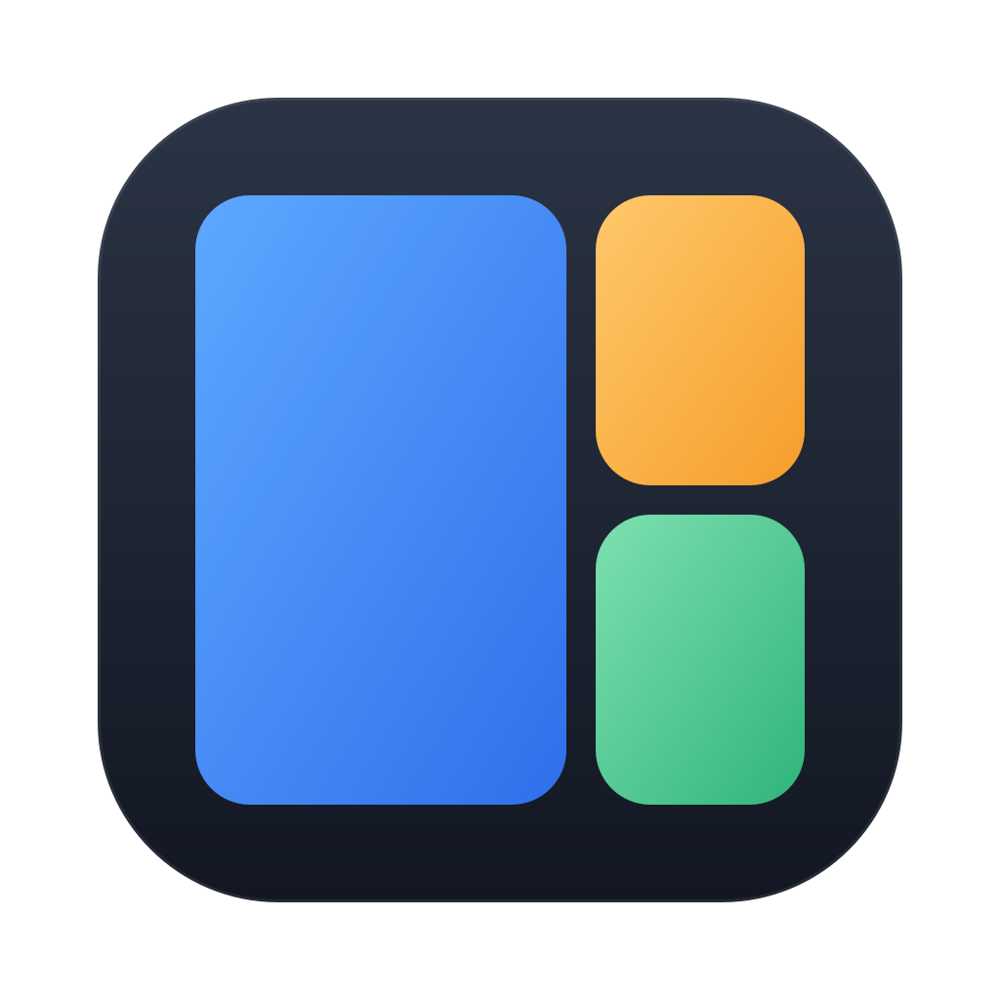
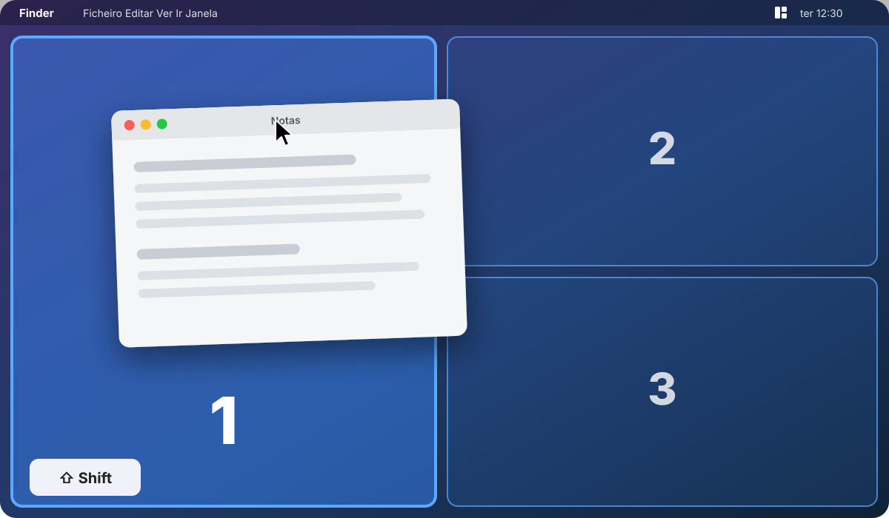

<p align="center">
  
</p>

<h1 align="center">Marmita</h1>

<p align="center">
  Arruma as janelas do Mac em zonas, como numa marmita.<br>
  Arrasta, segura <kbd>Shift</kbd>, larga. Pronto.
</p>

<p align="center">
  <a href="https://github.com/gustavos00/marmita/actions/workflows/ci.yml"></a>
  
  
  <a href="LICENSE"></a>
</p>

<p align="center">
  
</p>

A Marmita é um gestor de janelas por zonas para macOS, na linha do BentoBox e do FancyZones do Windows. Defines layouts com as zonas que quiseres; depois, ao arrastar uma janela com <kbd>Shift</kbd> premido, as zonas aparecem no ecrã e a janela encaixa e redimensiona-se na zona onde a largas. Vive na barra de menus, sem ícone no Dock, e é nativa: Swift, AppKit e SwiftUI, sem dependências.

## Funcionalidades

- **Encaixar por arrasto.** Segura a tecla (Shift, Option, Control ou Command, à escolha) enquanto arrastas uma janela pela barra de título; a zona debaixo do rato fica realçada e a janela encaixa ao largar.
- **Atalhos de teclado** para mover a janela ativa sem tocar no rato.
- **Editor de layouts.** Parte de um modelo ou desenha as zonas à mão, numa grelha que as alinha sozinha.
- **Vários monitores.** Cada ecrã tem o seu layout, e um atalho passa a janela para o ecrã seguinte.
- **Espaço entre zonas** ajustável, de 0 a 16 pt.
- **Abre ao iniciar sessão**, se quiseres.

## Atalhos

| Atalho | O que faz |
| --- | --- |
| <kbd>⌃</kbd><kbd>⌥</kbd><kbd>←</kbd> / <kbd>→</kbd> | Janela ativa para a zona anterior / seguinte |
| <kbd>⌃</kbd><kbd>⌥</kbd><kbd>1</kbd> … <kbd>9</kbd> | Janela ativa para a zona com esse número |
| <kbd>⌃</kbd><kbd>⌥</kbd><kbd>⌘</kbd><kbd>←</kbd> / <kbd>→</kbd> | Janela ativa para o ecrã anterior / seguinte, na mesma zona |
| Arrastar + <kbd>⇧</kbd> | Mostra as zonas; larga a janela numa delas |

As zonas são numeradas por ordem de leitura: de cima para baixo, da esquerda para a direita.

> Se usas o Rectangle ou outro gestor com <kbd>⌃</kbd><kbd>⌥</kbd> + setas, os atalhos chocam; fica com os de um deles.

## Instalar

Precisas do macOS 14 ou mais recente e do Xcode 16 (ou das Command Line Tools com Swift 6).

```bash
git clone https://github.com/gustavos00/marmita.git
cd marmita
./scripts/build-app.sh
open build/Marmita.app
```

Para a ter sempre à mão, copia `build/Marmita.app` para `/Applications` e liga *Abrir ao iniciar sessão* no menu.

### Permissão de Acessibilidade

Para mover janelas de outras apps, a Marmita precisa de acesso em **Definições do Sistema › Privacidade e Segurança › Acessibilidade**, e pede-o no primeiro arranque. Enquanto não o tiver, o ícone na barra de menus mostra um triângulo e o menu oferece *Conceder permissão…*. Assim que a permissão chega, a app passa a funcionar sem reiniciar.

O macOS associa a permissão à assinatura da app. O script assina *ad hoc* por omissão, e aí cada nova compilação conta como uma app diferente: é preciso remover a Marmita da lista e voltar a adicioná-la. Para a permissão sobreviver às compilações, assina com um certificado teu, por exemplo um "Apple Development" gratuito do Xcode:

```bash
SIGN_IDENTITY="Apple Development: o-teu-nome (EQUIPA)" ./scripts/build-app.sh
```

ou guarda o nome (ou o SHA-1) do certificado num ficheiro `.sign-identity` na raiz do projeto, que o script lê e o git ignora. `security find-identity -v -p codesigning` lista os que tens.

## Usar

1. Abre o menu da Marmita na barra de menus e escolhe um **Layout** para cada ecrã.
2. Arrasta uma janela pela barra de título, prime <kbd>Shift</kbd> e larga-a numa zona.
3. Em **Editar layouts…** crias os teus:
   - **+** cria um layout vazio ou a partir de um modelo (duas ou três colunas, grelhas 2×2 e 3×2, foco 2/3 + 1/3, principal + pilha);
   - arrasta numa área livre para desenhar uma zona, arrasta uma zona para a mover e o canto inferior direito para a redimensionar;
   - <kbd>⌘</kbd><kbd>⌫</kbd> apaga a zona selecionada;
   - **Usar em** escolhe o ecrã onde o layout fica ativo.

As preferências ficam em `~/Library/Application Support/Marmita/preferences.json`.

## Como funciona

| Peça | Onde | Como |
| --- | --- | --- |
| Zonas e geometria | `Sources/MarmitaCore` | Zonas em coordenadas unitárias (0…1), convertidas para cada ecrã; sem AppKit, coberto por testes |
| Mover janelas | `Accessibility.swift` | Accessibility API (`AXUIElement`), em coordenadas Quartz |
| Detetar o arrasto | `DragSnapper.swift` | Monitor global de eventos do rato; um arrasto conta quando a janela se move sem mudar de tamanho |
| Overlay | `Overlay.swift` | Um painel transparente, que deixa passar os cliques, por ecrã |
| Atalhos | `Hotkeys.swift` | `RegisterEventHotKey` do Carbon, que não precisa de permissão |
| Editor | `LayoutEditor.swift` | SwiftUI |
| Menu | `StatusMenu.swift` | `NSStatusItem`, refeito sempre que abre |

## Desenvolver

```bash
swift build          # compilar
swift test           # testes da lógica de zonas e das preferências
./scripts/build-app.sh   # montar build/Marmita.app
```

O CI compila com avisos tratados como erros, corre os testes e monta a app em cada push para `main` e em cada pull request.

## Licença

[MIT](LICENSE) © Gustavo Santos
